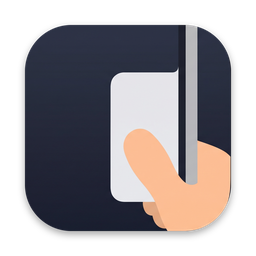

<div align="center">



# Thumbrail

**Quick controls under your thumb on the touchscreen MacBook Pro.**

Hold your laptop by the screen edges, slide a thumb in, and the controls you reach for most are right there.

[](https://github.com/PajamaDevil/thumbrail/releases/latest)
[](https://github.com/PajamaDevil/thumbrail/releases)
[](https://github.com/PajamaDevil/thumbrail/stargazers)
[](#-install)
[](Sources/Thumbrail)
[](LICENSE)

[**⬇️ Download the latest release**](https://github.com/PajamaDevil/thumbrail/releases/latest)

</div>

---

## ✨ What's inside

| | |
|---|---|
| 🔋 **Battery** | Charge level, charging status and time left |
| 🔊 **Volume** | Big vertical slider. Tap the speaker to mute |
| ☀️ **Brightness** | Big vertical slider for the built-in display |
| 🎵 **Music** | Play/pause, next and previous for any player |
| 📋 **Clipboard** | Your last 15 copied snippets. Tap one to copy it again |

The panel opens next to your thumb, from either edge, and the sliders sit closest to the side you swiped from.

## 📦 Install

1. Download `Thumbrail-x.y.z.zip` from [Releases](https://github.com/PajamaDevil/thumbrail/releases/latest).
2. Unzip it and drag **Thumbrail.app** into Applications.
3. The first time, **right-click → Open**, because the app isn't notarized yet.

<details>
<summary>macOS says the app is damaged?</summary>

```sh
xattr -dr com.apple.quarantine /Applications/Thumbrail.app
```
</details>

Thumbrail lives in your menu bar (look for the ✋ icon). The music buttons need Accessibility access, and the panel will ask for it.

## 👆 How to use it

- **Touchscreen:** slide a thumb in from the left or right edge.
- **Mouse or trackpad:** press at the very edge of the screen and drag inward.
- **Keyboard:** `⌃⌥←` or `⌃⌥→` to open or close it.

To close it, tap outside the panel or swipe it back toward the edge.

## 🛠️ Build from source

Requires Xcode 15 or newer.

```sh
git clone https://github.com/PajamaDevil/thumbrail
cd thumbrail
swift run                  # quick dev run
./Scripts/make-app.sh      # universal Thumbrail.app + zip in build/
```

New releases come from the **Release** workflow in the Actions tab. Run it with a version number and it builds and publishes the zip.

## ⚠️ Good to know

- macOS doesn't have a public touchscreen API yet, so Thumbrail uses a thin invisible strip on each edge that reacts to both touches and mouse drags.
- Brightness uses a private Apple framework, so the app can't be listed on the Mac App Store as it is.

## 📄 License

MIT © Yash Agrawal. See [LICENSE](LICENSE).

<div align="center">

If Thumbrail is handy, a ⭐ helps others find it.

</div>
